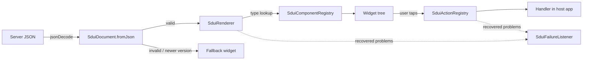

# Architecture

`sdui_playground` separates **what** a screen contains (data from the server)
from **how** it is drawn and **what happens** on interaction (code in the app).



## Layers

| Layer | Folder | Responsibility |
| --- | --- | --- |
| Schema | `lib/src/schema` | Parse and validate JSON into immutable `SduiDocument` / `SduiNode` / `SduiAction`. No Flutter imports. |
| Registry | `lib/src/registry` | Map component types to widget builders and action types to handlers. |
| Rendering | `lib/src/rendering` | `SduiRenderer` walks the tree; `SduiView` is the widget entry point. |
| Components | `lib/src/components` | Generic built-in components. Replaceable by the host app. |
| Failures | `lib/src/failures` | `SduiFailure` reports for everything the engine recovered from. |

## Failure model

The engine distinguishes two levels on purpose.

- **Document level, fail closed.** If the payload is malformed or declares a
  `schemaVersion` newer than the engine supports, nothing is rendered from it.
  A newer schema may change the tree shape, so guessing would be unsafe. The
  host shows a fallback (for example "please update the app").
- **Node level, fail soft.** An unknown component type, a builder that throws,
  or a node deeper than `SduiNode.maxDepth` is skipped and reported. The rest
  of the screen renders. This is what lets a server ship a new component before
  every client has it.

Props are read through `SduiProps`, whose accessors return `null` instead of
throwing on a wrong type, so a component can apply its own default.

## Extending

```dart
components.register('badge', (buildContext, node, children) {
  final props = SduiProps(node.props);
  return Chip(label: Text(props.string('label') ?? ''));
});

actions.register('navigate', (action, context) {
  final route = action.params['route'];
  if (route is String) Navigator.of(context).pushNamed(route);
});
```

## Schema evolution

- Adding optional fields or new components is **not** a version bump: older
  engines ignore unknown fields and skip unknown components.
- Changing the meaning of an existing field, or the document structure, **is**
  a bump of `schemaVersion`.
- The engine rejects versions above `SduiDocument.supportedSchemaVersion`.
